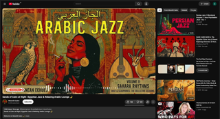

Did you notice something? If not, compare it to the image below. What you are seeing above is YouTube UI in a desktop monitor from 2010s, and below is from the present day, 2026. Perhaps, now you realize the same thing that I did—enshittification of YouTube UI. The thumbnails and video player are huge for the same screen size. I think Google learnt it from the smartphones that more immersive the medium is, easy it is to influence psychology of content consumer.

  

I was not aware of it until I tried Chrome-extensions, such as [this](https://vorapis.pages.dev/), that transformed YouTube to older designs.  Previously, everything on YouTube was bigger than my face. I did not like it. So after choosing older theme, I felt somehow relieved, like a burden has lifted from my shoulders—actually from my eyes. I found myself enjoying YouTube even more.

What do you think? These observations are from few days usage so perhaps it is just an illusion.
